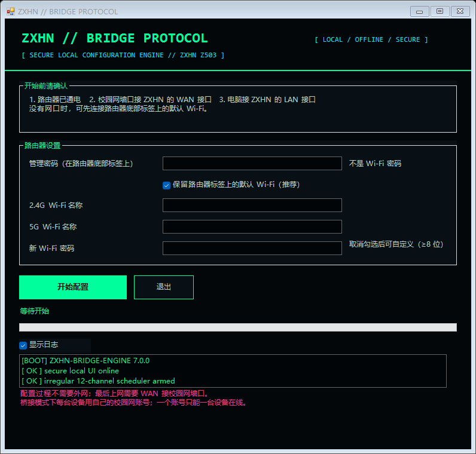

# ZXHN Z503 校园网一键桥接

中国移动 **ZXHN Z503** 路由器的 Windows 一键桥接工具。它通过本地网页自动化完成登录、选择 Bridge、设置 Wi-Fi 和最终确认，适合需要使用校园网桥接模式的场景。

> 当前版本：**v7.0.0**



## 功能

- 自动登录 ZXHN Z503 本地管理页面
- 自动选择桥接（Bridge）模式
- 默认保留路由器标签上的 Wi-Fi 信息
- 可选自定义 2.4G / 5G Wi-Fi 名称和密码
- 自动处理加载遮罩、弱密码提示和最终确认框
- 黑底霓虹绿黑客风界面
- 12 路终端视觉遥测随机出现、随机消失
- 配置视觉过程至少保持约 20 秒
- 全程只访问本地 `192.168.10.1`

## 下载

请前往 [GitHub Releases](https://github.com/blackcode233/zxhn-z503-campus-bridge/releases/latest) 下载：

```text
ZXHN-Z503-一键桥接-v7.zip
```

ZIP 内已包含便携版 `node.exe` 和 Playwright 依赖，解压后即可运行，不需要单独安装 Node.js。

## 使用

1. 路由器通电，校园网墙口接 ZXHN 的 WAN 接口。
2. 电脑连接 ZXHN 的 LAN 接口；没有网口时可连接路由器底部标签上的默认 Wi-Fi。
3. 解压 ZIP，双击 `启动配置.vbs`。
4. 输入路由器底部标签上的管理密码。
5. 点击“开始配置”，等待桥接切换和终端视觉效果完成。
6. 成功后连接 Wi-Fi，打开 `http://10.112.0.1`，用每台设备自己的校园网账号认证。

更完整的说明见 [docs/使用说明.txt](docs/使用说明.txt)。

## 系统要求

- Windows 10 / 11
- Microsoft Edge
- 中国移动 ZXHN Z503
- 路由器管理地址为 `192.168.10.1`

## 重要说明

- 桥接模式不会绕过多设备认证限制。每台设备仍需使用自己的校园网账号。
- 一个校园网账号通常只能有一台设备在线。
- 工具不会保存管理密码或 Wi-Fi 密码。密码只在运行时通过本地环境变量交给自动化进程。
- 工具不会上传密码、校园网账号或路由器配置。
- 如果路由器已经被改成桥接模式，`192.168.10.1` 可能不再可用，需要恢复出厂设置后再运行。
- 请遵守学校网络管理规定。

## 技术结构

| 文件 | 作用 |
| --- | --- |
| `启动配置.vbs` | 隐藏命令行后的主启动器 |
| `启动配置.bat` | 备用启动器 |
| `zxhn_gui.ps1` | PowerShell WinForms 主界面和随机窗口调度器 |
| `hacker_window.ps1` | 12 路视觉遥测终端 |
| `zxhn_bridge_tool.js` | Playwright 自动登录和 Bridge 配置引擎 |

终端里的滚动内容只是视觉演示，不会执行抓包、扫描、破解或提权命令。

## 开发

源码运行需要 Node.js、`playwright-core` 和 Microsoft Edge：

```powershell
npm install
node .\zxhn_bridge_tool.js --router 192.168.10.1
```

不传 `--apply` 时只走到确认页，不会提交配置。

## 发布包校验

Release 中的 `ZXHN-Z503-一键桥接-v7.zip` 对应 SHA256：

```text
3CE1C815F19A8158C09C18FCBE7746FA44BB14271132E80071CD858BD42F4050
```
